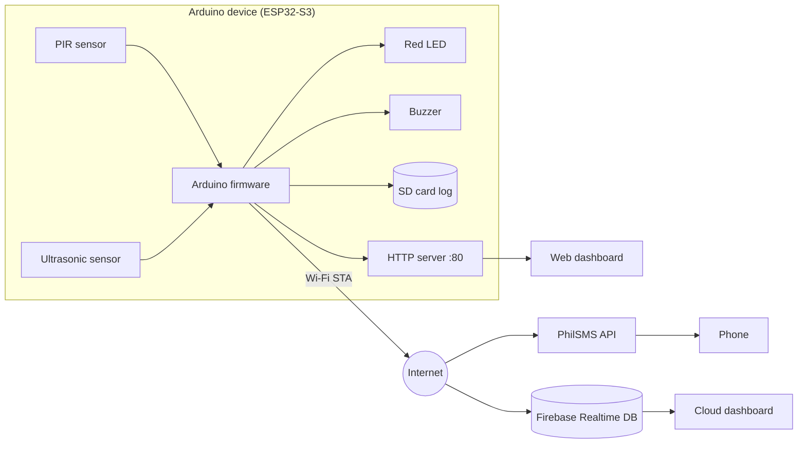

# S3-GUARD — Anti-Intruder Detection System

**S3-GUARD is an Arduino-based security device.** The firmware is an Arduino sketch
(`anti-intruder.ino`, written in Arduino C++) that runs on an **ESP32-S3** microcontroller.
It is not a simulated or purely software product: the program is compiled in the Arduino IDE
and flashed to a physical board, and that board reads real sensors, drives a real buzzer and
LED, logs to a real SD card, and sends real SMS alerts over the internet.

This repository contains the device firmware, the web dashboard that monitors it, and the
system documentation.

---

## Table of Contents

- [What it does](#what-it-does)
- [Hardware (the Arduino device)](#hardware-the-arduino-device)
- [Wiring and pin map](#wiring-and-pin-map)
- [How it works](#how-it-works)
- [System architecture](#system-architecture)
- [Repository contents](#repository-contents)
- [The dashboard](#the-dashboard)
- [HTTP API](#http-api)
- [Setup: building the device](#setup-building-the-device)
- [Configuration placeholders](#configuration-placeholders)
- [Event codes and severity](#event-codes-and-severity)
- [Security notes](#security-notes)
- [Limitations](#limitations)
- [Documentation](#documentation)

---

## What it does

S3-GUARD watches an area (for example a grain-drying yard or a doorway) and raises an alarm
when something enters a configurable range:

- **Detects intrusions** with an ultrasonic distance sensor (and optionally a PIR motion sensor).
- **Sounds a loud siren** and turns on a red LED while the zone is breached.
- **Sends an SMS alert** to a phone number through the PhilSMS API.
- **Saves every event** to the SD card and optionally streams it to Firebase Realtime Database.
- **Serves a live web dashboard** from the device itself over Wi-Fi, showing distance,
  alarms, history, analytics, and settings.
- **Keeps working offline** in Access Point mode; cloud features simply switch off if there
  is no internet connection.

---

## Hardware (the Arduino device)

| Component | Role |
|---|---|
| **ESP32-S3** (Arduino-compatible board) | Main microcontroller. Runs the Arduino sketch, Wi-Fi, web server, and alert logic. |
| **HC-SR04-style ultrasonic sensor** | Measures distance in centimetres (effective range ~2 cm to ~2 m). |
| **PIR motion sensor** (optional) | Detects general movement. Disabled by default in firmware. |
| **Red LED** | Lights up while an intrusion is active. |
| **Active buzzer / piezo** | Loud siren on detection (driven through a transistor, see below). |
| **microSD card (SD_MMC)** | Stores the event log (`/log.txt`) locally so data survives reboots. |
| **Power supply** | 5 V USB, or a 2×18650 battery pack / solar setup for field deployment. |

> **Buzzer wiring:** do not drive the buzzer directly from a GPIO pin. Use an NPN transistor
> (2N2222 / S8050 / BC547) with a 1 kΩ base resistor, a flyback diode across the buzzer, and a
> common ground. Details are in the comments at the top of `anti-intruder.ino`.

The firmware is built with the **Arduino IDE + ESP32 board package**. Libraries used are
bundled with the ESP32 Arduino core: `WiFi.h`, `WebServer.h`, `WiFiClientSecure.h`,
`HTTPClient.h`, `SD_MMC.h`, `time.h`, plus FreeRTOS tasks.

---

## Wiring and pin map

| Signal | ESP32-S3 GPIO | Notes |
|---|---|---|
| PIR output | **5** | Digital input (`USE_PIR = false` by default) |
| Ultrasonic TRIG | **2** | Digital output |
| Ultrasonic ECHO | **1** | Digital input |
| Red LED | **41** | Digital output |
| Buzzer | **42** | Digital output via transistor driver |

To re-enable PIR detection, set `USE_PIR = true` in `anti-intruder.ino`.

---

## How it works

1. **Boot.** The ESP32 starts a Wi-Fi Access Point named `S3-GUARD-PRO` and simultaneously
   tries to join a home Wi-Fi network for internet access. Sensors are initialised, the LED
   and buzzer are forced off, and the SD card is mounted.
2. **Time sync.** If the internet is reachable, the clock is synchronised over NTP
   (Asia/Manila, UTC+8) so events can be reported with a real date, day, and time.
3. **Sensing loop (Core 1).** Every 60 ms the ultrasonic sensor is pinged three times and the
   **median** reading is kept, which rejects spikes and missed echoes. A reading only counts
   as an intrusion after **3 consecutive in-range reads** (debounce), which prevents false
   alarms.
4. **Alarm.** While the zone is breached the LED stays on and the buzzer plays a 2.5–3.2 kHz
   siren warble. One event is recorded per intrusion (not per loop iteration).
5. **Logging.** Each event is written to the SD card as a line of key/value text and queued
   for Firebase. Up to 200 events are kept in a circular buffer.
6. **Alerting (Core 0).** A dedicated background task sends the SMS through PhilSMS and pushes
   live status plus new events to Firebase, so network delays never block sensing.
7. **Monitoring.** The device runs an HTTP server on port 80 and serves the dashboard plus
   JSON endpoints. The dashboard polls `/status` twice a second.

Each event records: id, uptime, distance, PIR state, severity, type, and (when time is synced)
full date, day name, and time.

---

## System architecture

- **Core 1** runs the sensing loop and the web server.
- **Core 0** runs the background worker that sends SMS and syncs Firebase.

---

## Repository contents

| File | Description |
|---|---|
| `anti-intruder.ino` | **Arduino firmware** for the ESP32-S3. Contains the sensing logic, alarm, SD logging, SMS, Firebase sync, and the embedded dashboard HTML. |
| `dashboard.html` | Standalone dashboard. Open it in a browser and point it at the device IP, or use it in Firebase cloud mode. |
| `dashboard.php` | Same dashboard wrapped in PHP so it can be served from XAMPP or any PHP host, with `?ip=` support. |
| `preview.html` | Demo/preview mode with simulated data — useful for showing the UI without a device. |
| `S3-GUARD_System_Documentation.docx` | Technical documentation of the system. |
| `S3-GUARD_System_Explanation.docx` | Plain-language explanation, build process, and deployment tips. |

> **Arduino IDE tip:** the IDE expects the sketch folder to have the same name as the `.ino`
> file. If you clone this repository as `anti-intruder-dashboard`, either rename the folder to
> `anti-intruder`, or copy `anti-intruder.ino` into a folder named `anti-intruder` before
> opening it.

---

## The dashboard

The dashboard is a single-page app (HTML/CSS/vanilla JS) with a light, minimal design and full
mobile support. It has four sections:

- **Dashboard** — total intrusions, current distance, uptime, network status, live distance
  chart, proximity radar bar, PIR/zone status, device info, and recent events.
- **History** — full event timeline with severity filters (High / Medium / Low) and CSV export
  including date, day, and time.
- **Analytics** — peak / minimum / average distance, distance distribution chart, and session
  statistics broken down by severity, intrusions, and motions.
- **System** — hardware status, alert threshold and sound settings, event management
  (refresh/clear), connection details (IP, RSSI, uptime), SMS status, and remote-access
  controls.

It can run in three ways:

1. **From the device** — join the `S3-GUARD-PRO` Wi-Fi network and open `http://192.168.4.1`.
   The firmware serves the embedded copy of the dashboard.
2. **Standalone file / PHP host** — open `dashboard.html` (or `dashboard.php` on XAMPP) and
   enter the device IP, e.g. `?ip=192.168.4.1`. CORS is enabled on the device.
3. **Cloud mode** — with a Firebase project configured, the dashboard subscribes to the
   Realtime Database and can be hosted anywhere, as long as the device has internet access.

---

## HTTP API

All endpoints return JSON and allow cross-origin requests.

| Method | Endpoint | Purpose |
|---|---|---|
| `GET` | `/` | Serves the embedded dashboard |
| `GET` | `/status` | Live motion, distance, count, threshold, uptime, RSSI, network, SMS state, date/time |
| `POST` | `/threshold?val=<cm>` | Set the alert threshold (10–400 cm) |
| `POST` | `/sound?enable=<true\|false>` | Enable or mute the buzzer |
| `GET` | `/events` | All stored events, newest first |
| `GET` | `/events/stats` | Totals, severity counts, peak/min/average distance |
| `GET` | `/events/report[?day=YYYY-MM-DD]` | Events with day/time fields, optionally filtered by day |
| `GET` | `/events/daily` | Per-day event counts |
| `POST` | `/events/clear` | Clear all events (memory + SD log) |
| `POST` | `/time/resync` | Re-run NTP time sync |
| `GET` | `/logs` | Raw SD card log file (`/log.txt`) |

---

## Setup: building the device

### 1. Assemble the hardware

Wire the sensors, LED, and buzzer according to the [pin map](#wiring-and-pin-map). Use a
transistor driver for the buzzer and make sure everything shares a common ground.

### 2. Prepare the Arduino IDE

1. Install the **Arduino IDE**.
2. Add the **ESP32 board package** (Espressif) via Boards Manager.
3. Select your **ESP32-S3** board and the correct COM port.

### 3. Configure your values

Open `anti-intruder.ino` and replace every placeholder listed in
[Configuration placeholders](#configuration-placeholders) with your own values. At minimum set
the Wi-Fi name/password and the Access Point password.

### 4. Flash the device

Compile and upload the sketch. Open the Serial Monitor at **115200 baud** to watch boot
messages and live sensor diagnostics (distance, debounce counter, PIR state).

### 5. Connect to the device

- Join the Wi-Fi network `S3-GUARD-PRO` using your configured AP password.
- Open **http://192.168.4.1** in a browser.
- The dashboard should show live distance and an `ONLINE` badge.

If the device also joined your home Wi-Fi, SMS and Firebase sync become available
automatically; otherwise the system still runs locally.

### 6. Run the dashboard elsewhere (optional)

- **XAMPP:** place the project in `htdocs`, start Apache, and open
  `http://localhost/anti-intruder/dashboard.php?ip=192.168.4.1`.
- **Static hosting:** upload `dashboard.html` and add your Firebase config for cloud mode.
- **Demo only:** open `preview.html` — no device required.

---

## Configuration placeholders

These values are intentionally **not** committed. Replace them with your own before flashing:

| Placeholder | File | Meaning |
|---|---|---|
| `YOUR_WIFI_SSID` / `YOUR_WIFI_PASSWORD` | `anti-intruder.ino` | Home Wi-Fi used for internet (SMS + Firebase) |
| `YOUR_AP_PASSWORD` | `anti-intruder.ino` | Password for the device's own `S3-GUARD-PRO` network |
| `YOUR_PHILSMS_API_TOKEN` | `anti-intruder.ino`, `dashboard.html`, `dashboard.php` | PhilSMS API v3 token |
| `YOUR_PHONE_NUMBER` / `639XXXXXXXXX` | same files | SMS recipient in international format |
| `YOUR_PROJECT_ID` | `anti-intruder.ino`, `dashboard.html`, `dashboard.php` | Firebase project / Realtime Database |
| `YOUR_FIREBASE_WEB_API_KEY`, `YOUR_SENDER_ID`, `YOUR_FIREBASE_APP_ID` | `dashboard.html`, `dashboard.php` | Firebase web app config |

---

## Event codes and severity

**Severity** is derived from distance:

| Code | Meaning | Distance |
|---|---|---|
| `H` | High | below 60 cm |
| `M` | Medium | 60–130 cm |
| `L` | Low | 130 cm and above |

**Type** describes what triggered the event:

| Code | Meaning |
|---|---|
| `B` | Both PIR and ultrasonic |
| `U` | Ultrasonic only |
| `P` | PIR only |
| `I` | Intrusion |
| `M` | Motion (out of range) |

---

## Security notes

- **Change the Access Point password.** Anyone within radio range who has the password can
  reach the dashboard, and the dashboard has no login.
- **Never commit real credentials.** All tokens, passwords, and project IDs in this repository
  are placeholders. Keep your own values local and out of version control.
- **Secure your Firebase rules.** A public Realtime Database with open rules lets anyone read
  or write your data. Use authentication and restrictive rules.
- **SMS costs money.** Each alert consumes PhilSMS credit; protect the token and monitor usage.
- The device uses `setInsecure()` for TLS to keep the firmware small. For production, pin
  certificates instead.

---

## Limitations

- Ultrasonic detection is directional and needs a clear line of sight; soft or angled surfaces
  reduce range.
- Reliable detection is around 2 m (400 cm is the hard ceiling, with lower accuracy).
- SMS and cloud sync require internet; without it the device runs in local-only mode.
- The dashboard is unauthenticated and intended for trusted local networks.
- NTP must succeed for dates/times to appear; otherwise events show device uptime.

---

## Documentation

- `S3-GUARD_System_Documentation.docx` — hardware, processes, internal logic, build steps.
- `S3-GUARD_System_Explanation.docx` — full explanation, deployment tips, and how the system
  helps farmers protect drying grains.

---

*S3-GUARD is an educational/capstone-style Arduino project. Built with an ESP32-S3, the
Arduino IDE, and a lot of sensor debugging.*
